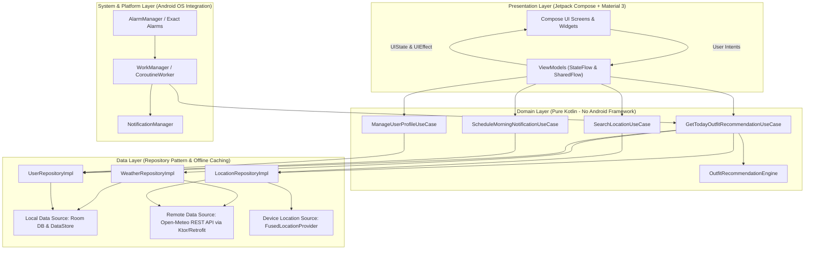
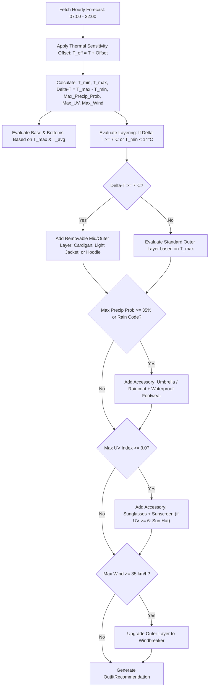
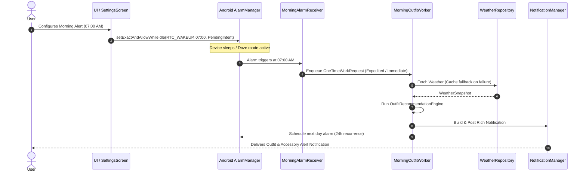
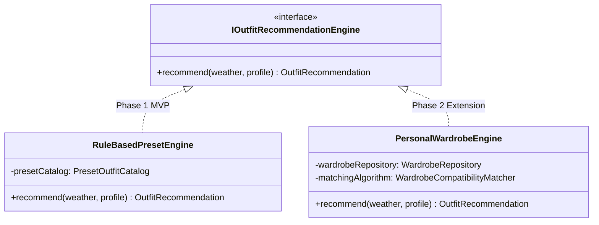

# ShowMeOutfit - Architecture Specification

| Attribute | Specification Details |
| :--- | :--- |
| **Document ID** | `SMO-ARCH-SPEC` |
| **Document Version** | `1.0.0` |
| **Status** | `APPROVED` |
| **Target Platform** | Android (Min SDK 26, Target SDK 35/37) |
| **Primary Language** | Kotlin 2.2+ |
| **UI Framework** | Jetpack Compose (Material 3) |
| **Architecture Pattern** | Clean Architecture + MVI / Unidirectional Data Flow (UDF) |
| **Storage / Sync** | Standalone Local Client (Room DB + DataStore), No Backend Middleware |
| **Repository** | Git (Tracked under `docs/architecture/`) |

---

## Revision History

| Version | Date | Author | Description of Changes |
| :--- | :--- | :--- | :--- |
| **v1.0.0** | Oct 2026 | Senior Android Architect | Initial approved baseline architecture: Clean Architecture design, diurnal recommendation engine, standalone offline-first strategy, and battery-compliant morning scheduling. |

---

## 1. System Overview & Core Capabilities

**ShowMeOutfit** is an offline-capable, standalone native Android application that recommends weather-appropriate clothing and accessories.

### Key Capabilities
1. **Zero-Backend Standalone Architecture:** Runs independently on the client device. Queries public weather data directly via the open Open-Meteo REST API, eliminating the need for custom server infrastructure and client API key management.
2. **Dual Operational Modes:**
   - **Mode 1 (Scheduled Morning Alert):** Delivers a rich, glanceable notification at a user-scheduled wake-up time (e.g., 07:00 AM) summarizing the day's outfit layers and critical gear to bring.
   - **Mode 2 (Interactive On-Demand):** Real-time interactive in-app dashboard allowing users to inspect the day's outfit, diurnal temperature curve, hourly rain/UV timelines, and manual location lookups.
3. **All-Day Diurnal Intelligence:** Unlike conventional weather apps that only check morning temperatures, ShowMeOutfit evaluates the full daylight spectrum (07:00 – 22:00) to account for diurnal temperature swings ($\Delta T = T_{\max} - T_{\min}$) and prescribe removable layers.
4. **Lightweight Personalization:** Dynamically adjusts recommendations based on gender preference and individual thermal sensitivity offsets ($T_{\text{eff}} = T_{\text{apparent}} + \text{offset}$).
5. **Future-Proof Extensibility:** Built with strict domain boundaries allowing seamless future expansion to a user-managed digital wardrobe (virtual closet) without rewriting data or presentation layers.

---

## 2. System Architecture

The application implements **Clean Architecture** with **MVI (Model-View-Intent) / Unidirectional Data Flow (UDF)** in the presentation layer.



### Architectural Boundaries & Invariants

1. **Domain Layer Independence:** Contains **zero** imports from `android.*`. Business logic, diurnal algorithms, and value objects are pure Kotlin and 100% unit-testable on a standard JVM.
2. **Unidirectional Data Flow (UDF):** The UI emits user intents (`RefreshWeatherIntent`, `UpdateSettingsIntent`) to ViewModels. ViewModels expose immutable `StateFlow<UiState>` and single-event `SharedFlow<UiEffect>`.
3. **Repository Pattern:** Repositories encapsulate the caching logic, hiding network calls and Room SQLite queries behind clean domain interfaces.

---

## 3. Domain Model & Diurnal Recommendation Algorithm

### 3.1 Domain Models

```kotlin
// Weather Entities
data class WeatherSnapshot(
    val location: LocationInfo,
    val fetchedAt: Instant,
    val current: CurrentCondition,
    val hourlyForecast: List<HourlyCondition>,
    val dailyForecast: DailySummary
)

data class HourlyCondition(
    val time: LocalDateTime,
    val temperatureCelsius: Double,
    val apparentTemperatureCelsius: Double,
    val precipitationProbability: Int, // 0 - 100%
    val uvIndex: Double,
    val windSpeedKmh: Double,
    val weatherCode: WeatherCode // WMO standard code
)

// User Profile & Personalization
enum class GenderPreference { ALL, MEN, WOMEN }
enum class ThermalSensitivity(val tempOffsetCelsius: Double) {
    FEELS_COLD_EASILY(+2.5), // Needs warmer clothing at higher thresholds
    NEUTRAL(0.0),
    FEELS_WARM_EASILY(-2.5)  // Tolerates lower temperatures
}

data class UserProfile(
    val genderPreference: GenderPreference = GenderPreference.ALL,
    val thermalSensitivity: ThermalSensitivity = ThermalSensitivity.NEUTRAL,
    val morningNotificationTime: LocalTime = LocalTime.of(7, 0),
    val isNotificationEnabled: Boolean = true,
    val selectedLocation: LocationInfo? = null // null = GPS auto-detect
)

// Output Recommendations
data class OutfitRecommendation(
    val headline: String,
    val summaryDescription: String,
    val baseLayer: Garment,
    val midLayer: Garment?,
    val outerLayer: Garment?,
    val bottomLayer: Garment,
    val footwear: Garment,
    val accessories: List<AccessoryAlert>,
    val weatherHighlights: WeatherHighlights
)

data class AccessoryAlert(
    val type: AccessoryType,
    val name: String,
    val reason: String,
    val priority: PriorityLevel
)

enum class AccessoryType { UMBRELLA, SUNGLASSES, SUN_HAT, SCARF, GLOVES, EXTRA_EVENING_LAYER }
enum class PriorityLevel { CRITICAL, RECOMMENDED, OPTIONAL }
```

### 3.2 Diurnal Recommendation Flowchart



### 3.3 Layering Temperature Matrix ($T_{\text{eff}}$)

| Effective Temp ($T_{\text{eff}}$) | Base Layer | Mid Layer | Outer Layer | Bottoms & Shoes | Accessories |
| :--- | :--- | :--- | :--- | :--- | :--- |
| **$< 0^\circ\text{C}$ (Extreme Cold)** | Thermal Undershirt | Wool Sweater | Down Parka | Thermal Pants + Winter Boots | Beanie, Gloves, Heavy Scarf |
| **$0^\circ\text{C} – 10^\circ\text{C}$ (Cold)** | Long-sleeve Cotton Shirt | Knitted Sweater | Wool Coat / Puffer | Chinos/Jeans + Leather Boots | Light Scarf, Umbrella (if rain) |
| **$10^\circ\text{C} – 16^\circ\text{C}$ (Cool)** | Breathable Cotton Tee | Cardigan / Hoodie | Denim or Light Jacket | Trousers + Sneakers | Removable Layer if $\Delta T \ge 7^\circ\text{C}$ |
| **$16^\circ\text{C} – 22^\circ\text{C}$ (Mild)** | Cotton T-Shirt / Polo | None | Optional Overshirt | Chinos + Casual Shoes | Sunglasses if UV $\ge 3$ |
| **$22^\circ\text{C} – 28^\circ\text{C}$ (Warm)** | Lightweight Linen / Tee | None | None | Shorts / Chinos + Loafers | Sunglasses, Sunscreen |
| **$> 28^\circ\text{C}$ (Hot)** | Ultra-light Linen / Tank | None | None | Shorts + Sandals / Canvas | Sun Hat, Sunglasses, Sunscreen |

---

## 4. Technical Stack Decision Matrix & Trade-offs

| Component | Selected Stack | Alternative | Pros & Advantages | Cons & Trade-offs |
| :--- | :--- | :--- | :--- | :--- |
| **UI Framework** | **Jetpack Compose (Material 3)** | Traditional XML | Declarative state, modern animation APIs, dynamic theming, reduced boilerplate. | Initial clean compilation overhead. |
| **Dependency Injection** | **Koin 4.x** | Hilt / Dagger | Pure Kotlin DSL, zero KSP/kapt annotation processing overhead, rapid builds. | Runtime dependency resolution rather than compile-time check. |
| **Weather API** | **Open-Meteo REST API** | OpenWeatherMap | **Zero API key required** (no credential exposure risk in standalone client), hourly data. | 10,000 requests/day per IP limit (abundant for local client). |
| **Networking** | **Ktor Client 3.x** | Retrofit + OkHttp | Native multiplatform coroutines, lightweight footprint, Kotlinx.serialization integration. | Slightly different syntax than classic Retrofit. |
| **Persistence** | **Room DB + DataStore** | SharedPreferences | Type-safe SQL with reactive Flow observation; DataStore provides transactional writes. | Migration definitions required for schema version updates. |
| **Background Scheduling** | **AlarmManager + WorkManager** | Periodic WorkManager | Guaranteed exact minute wake-up during Android Doze mode; reliable network retry backoff. | Requires Android 12+ `SCHEDULE_EXACT_ALARM` permission handling. |

---

## 5. Background Scheduling & Notification Architecture

Delivering reliable morning notifications without a push backend requires explicit coordination with Android OS power management:



### OS Compliance Details
1. **Android 13+ Notification Permissions (`POST_NOTIFICATIONS`):** Handled with runtime permission checks and user-facing educational rationale.
2. **Android 12+ Exact Alarm Restriction (`SCHEDULE_EXACT_ALARM`):** Graceful degradation to `WorkManager.PeriodicWorkRequestBuilder` if exact alarm access is unavailable.
3. **Reboot Recovery (`RECEIVE_BOOT_COMPLETED`):** `BootCompletedReceiver` re-registers scheduled alarms after device restarts.

---

## 6. Offline-First Caching Strategy

1. **Snapshot Caching:** Successful forecasts are persisted in Room with an epoch timestamp.
2. **Freshness Window:** Data is fresh for **3 hours**. If the user opens the app or the morning alarm triggers offline:
   - Data $< 12$ hours old is used with a badge: *"Cached forecast"*.
   - Data older than 24 hours displays an offline state prompting retry when network returns.
3. **Location Caching:** Coordinates and city name are saved in DataStore so background workers do not stall waiting for a GPS lock.

---

## 7. Extension Roadmap: Evolving to a Virtual Wardrobe

The engine interface ensures that evolving from rule presets to a personal wardrobe requires **zero changes** to UI or data layers:


