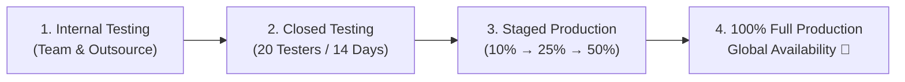

# Google Play Store Release Runbook & Submission Guide (v1.0.0)

**Application:** ShowMeOutfit  
**Package Name:** `com.smoh.showmeoutfit`  
**Version Code:** `1` (or monotonic CI run number)  
**Version Name:** `1.0.0`  
**Target SDK:** 37 (Exceeds Google Play API 34+ requirement)  
**Minimum SDK:** 26 (Android 8.0 Oreo)  
**Binary Format:** Android App Bundle (`.aab`) with R8 minification  

---

## 1. Store Listing Metadata & Copywriting

### 1.1 App Title (Max 30 characters)
```text
ShowMeOutfit: Weather Outfits
```

### 1.2 Short Description (Max 80 characters)
```text
Smart daily outfit & gear advice based on diurnal weather swings & rain alerts.
```

### 1.3 Full Description (Max 4,000 characters)
```text
Never get caught underdressed or shivering in the evening again. ShowMeOutfit is an intelligent, offline-first personal clothing and accessory advisor powered by real-time diurnal weather analysis.

Unlike conventional weather apps that only check morning temperatures, ShowMeOutfit analyzes the entire daytime temperature swing (ΔT between 07:00 and 22:00) to recommend the exact clothing layers you need—including removable cardigans, light jackets, and evening layers.

WHY SHOWMEOUTFIT?

🧥 DIURNAL TEMPERATURE INTELLIGENCE
• Big temperature drop between morning and afternoon? The app automatically prescribes smart layering: base shirts, removable mid-layers, and outer jackets.
• Personalized thermal sensitivity: Adjust thresholds if you feel cold easily (+2.5°C) or feel warm easily (-2.5°C).
• Custom fit preferences: Recommendations tailored for Unisex, Men, or Women.

☔ TIMED ACCESSORY & WEATHER SPIKE ALERTS
• Rain Window Alerts: Know hours ahead if rain probability exceeds 35% with tailored umbrella reminders.
• UV Protection: Sunglasses and sunscreen warnings for UV index ≥ 3; sun hat alerts for UV ≥ 6.
• Wind Protection: Automatic windbreaker recommendations when gusts reach 35 km/h.

⏰ AUTONOMOUS SCHEDULED MORNING ALERT
• Wake up to a glanceable notification at your scheduled time (e.g., 07:00 AM) summarizing the day’s outfit layers and critical gear before you step out of bed.
• Battery-optimized exact wake-up: Operates reliably even during Android Doze sleep mode without draining battery.

🔒 ZERO-BACKEND PRIVACY FIRST
• Standalone Client: Direct client queries to the open Open-Meteo REST API. No intermediate proxy servers.
• No Account Required: No registration, no email, no phone number, and zero personal data collection.
• 100% Offline-First: Stores forecasts on-device with 12-hour offline fallback.

☀️ BEAUTIFUL MATERIAL 3 DESIGN
• Modern Jetpack Compose dashboard with interactive diurnal temperature curves.
• Visual outfit cards and timeline highlights.
• Full TalkBack screen reader accessibility and 200% dynamic font scaling support.

Download ShowMeOutfit today and dress confidently for whatever the day brings!
```

---

## 2. Graphic Assets Checklist

| Asset | Requirements | Current Status / File Path |
| :--- | :--- | :--- |
| **App Icon** | 512 × 512 px, 32-bit PNG with alpha, max 1024 KB | ✅ Ready: [`docs/design/branding/app_icon_512.png`](../design/branding/app_icon_512.png) |
| **Feature Graphic** | 1024 × 500 px, 24-bit PNG or JPG (no alpha) | ⚠️ Generated below (Warm cream canvas, S-M-O emblem, branding title) |
| **Phone Screenshots** | Min 2, max 8. Aspect ratio 16:9 or 9:16 (e.g. 1080 × 2400 px) | 📸 Capture from API 37 AVD / Device (Dashboard, Timeline, Settings) |
| **7-inch Tablet Screenshots** | Optional for v1.0.0 (Recommended for tablet listing) | Post-v1.0.0 enhancement |

---

## 3. Data Safety Form Responses (Google Play Console)

Google Play requires completing the **Data Safety** questionnaire. Below are the precise answers matching ShowMeOutfit's zero-backend architecture:

### 3.1 Data Collection & Sharing Overview
* **Does your app collect or share any user data?**  
  👉 **Yes** (Location data is collected ephemerally solely for weather forecasting).
* **Is all of the user data collected by your app encrypted in transit?**  
  👉 **Yes** (All requests use HTTPS/TLS).
* **Do you provide a way for users to request that their data be deleted?**  
  👉 **Yes** (Users can clear data via Android App Settings or uninstall the app; no server-side retention exists).

### 3.2 Data Types Breakdown

#### Data Type: Location
* **Approximate Location (`ACCESS_COARSE_LOCATION`):**
  - **Collected:** Yes
  - **Shared:** No (Transmitted directly to Open-Meteo API for weather, not shared with third parties)
  - **Ephemeral processing?** Yes (Coordinates are not stored on remote servers)
  - **Is this data required or optional?** Optional (Users can choose manual city search instead)
  - **Purpose:** App functionality (Local weather forecast and diurnal outfit computation)
* **Precise Location (`ACCESS_FINE_LOCATION`):**
  - **Collected:** Yes (Same answers as Approximate Location)

#### All Other Data Categories:
* **Personal Info (Name, Email, Phone, Address, User IDs):** 👉 **None collected**
* **Financial Info:** 👉 **None collected**
* **Health and Fitness:** 👉 **None collected**
* **Messages, Photos, Videos, Audio:** 👉 **None collected**
* **Files and Docs:** 👉 **None collected**
* **Calendar:** 👉 **None collected**
* **Contacts:** 👉 **None collected**
* **App Activity & Performance (Crashlytics, Analytics):** 👉 **None collected**

---

## 4. App Content Declarations & Sensitive Permissions

### 4.1 Privacy Policy URL
```text
https://smoh-apps.github.io/ShowMeOutfit/privacy.html
```
*(Alternative repository URL: `https://github.com/smoh-apps/ShowMeOutfit/blob/main/docs/legal/PRIVACY_POLICY.md`)*

### 4.2 Exact Alarm Permission (`SCHEDULE_EXACT_ALARM`)
* **Declaration Requirement:** Google Play enforces strict eligibility for `SCHEDULE_EXACT_ALARM`.
* **Category Selection:** **Alarm, timer, or calendar reminders**
* **Justification Statement:**
  > *"ShowMeOutfit provides an autonomous morning outfit alert scheduled at an exact user-specified time (e.g. 07:00 AM). Exact timing is critical so the user receives appropriate clothing layer and accessory recommendations (such as impending rain or freezing temperatures) before getting dressed and leaving home. Inexact alarms that drift or defer during Android Doze mode would deliver morning attire advice hours late, defeating the core utility of the app. The app also implements a graceful fallback to WorkManager if the user chooses to revoke the permission."*

### 4.3 Target Audience & Content Rating
* **Target Age:** 13 and older (or General Audience).
* **Does the app appeal to children?** No.
* **Content Rating Questionnaire:** Everyone (PEGI 3, ESRB Everyone). Zero violence, zero user interaction/chat, zero location sharing with other users.

### 4.4 Ads Declaration
* **Does your app contain advertisements?**  
  👉 **No, my app does not contain ads.**

---

## 5. Build & Signing Procedure

### 5.1 Producing the Signed Production Bundle (`.aab`)
With your production keystore available (`showmeoutfit-release.jks` outside the repo):

```powershell
# Set release signing environment variables
$env:JAVA_HOME = "C:\Program Files\Android\Android Studio\jbr"
$env:RELEASE_KEYSTORE_PATH = "C:\Users\<user>\keys\showmeoutfit-release.jks"
$env:RELEASE_KEYSTORE_PASSWORD = "<keystore-password>"
$env:RELEASE_KEY_ALIAS = "showmeoutfit-release"
$env:RELEASE_KEY_PASSWORD = "<key-password>"

# Build optimized release bundle and mapping
.\gradlew.bat bundleRelease

# Verify artifact signature
& "$env:JAVA_HOME\bin\jarsigner.exe" -verify app\build\outputs\bundle\release\app-release.aab
```

### 5.2 Upload Artifacts to Play Console
1. **App Bundle:** `app/build/outputs/bundle/release/app-release.aab` (~7.6 MB)
2. **Deobfuscation File:** `app/build/outputs/mapping/release/mapping.txt` (Upload under *App Bundle > ReTrace Mapping* to enable clear stack traces in Google Play vitals).

---

## 6. Staged Rollout Strategy

To guarantee stability, follow this staged rollout schedule:



1. **Internal Testing Track (Day 1):** Validate upload key, Google Play App Signing enrollment, and initial download verification.
2. **Closed Testing Track (Days 2–15):** Meet Google Play's 20-tester requirement for personal developer accounts if applicable.
3. **Production Staged Rollout:**
   * Day 1: 10% rollout (Monitor crash rate and ANR rate in Play Console Vitals).
   * Day 3: 25% rollout.
   * Day 5: 50% rollout.
   * Day 7: 100% full availability.
